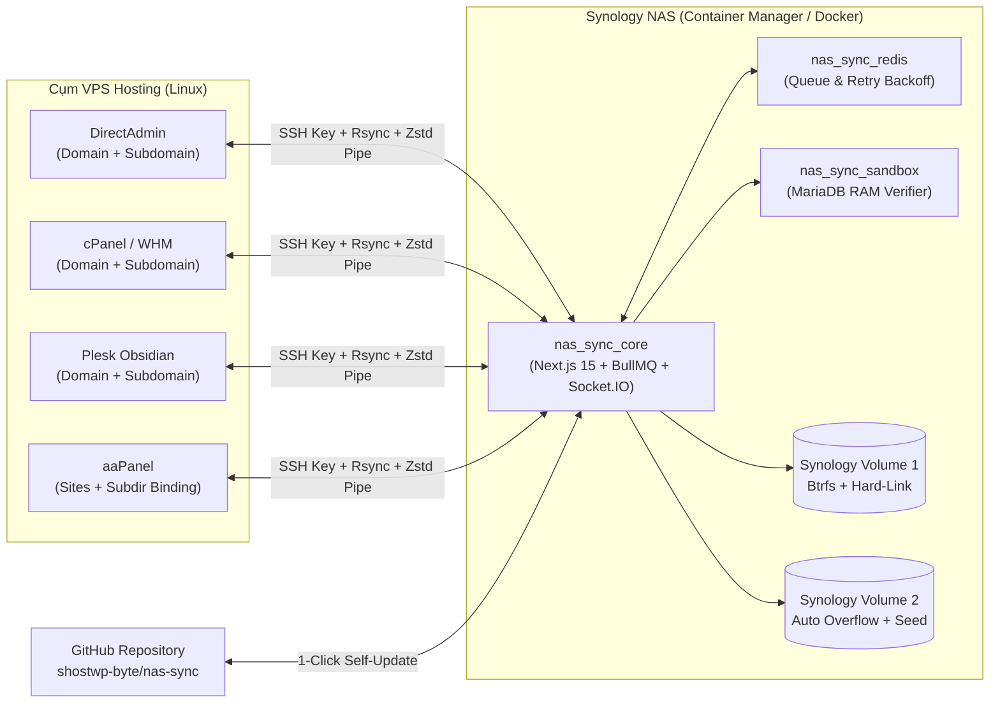

# 🛡️ NAS-Sync — Open-Source Agentless Multi-Panel Backup Platform for Synology NAS

[](https://github.com/shostwp-byte/nas-sync/blob/main/LICENSE)
[](https://github.com/shostwp-byte/nas-sync/releases)
[](https://nodejs.org/)
[](https://www.synology.com/)
[](https://github.com/shostwp-byte/nas-sync/pulls)

**NAS-Sync** (<https://github.com/shostwp-byte/nas-sync>) là nền tảng mã nguồn mở **hoàn toàn miễn phí (MIT License)** giúp tự động sao lưu tập trung, kiểm định toàn vẹn Database và khôi phục chéo (Cross-Panel Migration) hàng chục máy chủ Hosting/VPS về thiết bị **Synology NAS** mà không cần cài đặt bất kỳ Agent nào lên VPS.

---

## ✨ Tính năng Cốt lõi (Key Features)

- **🔌 Kiến trúc Agentless Pull & Zero-Impact trên VPS**:
  - NAS chủ động kết nối một chiều qua SSH Key (`Ed25519` / `RSA`) về VPS — nếu VPS bị tấn công hoặc nhiễm mã độc, hacker **tuyệt đối không có quyền ngược lại** để xóa bản sao lưu trên NAS.
  - Mọi tiến trình đọc file/dump SQL trên VPS đều tự động bọc trong `ionice -c 2 -n 7 nice -n 19` và giới hạn băng thông `--bwlimit`, không gây nghẽn CPU hay Disk I/O của website đang chạy.
- **🌐 Tự động Quét Đa Control Panel (Đầy đủ Domain, Addon Domain & Subdomain)**:
  - **DirectAdmin**: Tự động đọc `domains.list`, `<domain>.subdomains`, `<domain>.subdomains.docroot.override` (hỗ trợ cả cấu trúc thư mục độc lập lẫn thư mục con lồng nhau) và MySQL `mysql.conf`.
  - **cPanel / WHM**: Tự động đọc `/etc/userdatadomains`, `/var/cpanel/userdata/` và `/root/.my.cnf` kèm lọc trùng thông minh.
  - **Plesk Obsidian**: Truy vấn trực tiếp CSDL `psa` lấy toàn bộ Subscription, Domain & Subdomain kèm ánh xạ Database.
  - **aaPanel / BT Panel**: Đọc SQLite `default.db` (`sites` + `binding` subdirectory).
  - **Chống sao lưu trùng lặp (Nested Webroot Deduplication)**: Tự động tách riêng các Subdomain nằm lồng bên trong `public_html` của domain cha và bảo vệ thư mục Subdomain khi chạy Restore domain cha.
- **💾 Sao lưu Tăng dần Hard-Link (`rsync --link-dest`) & Zero-Temp-Disk SQL Stream**:
  - Tiết kiệm **85% – 95% dung lượng ổ cứng NAS**: các file không thay đổi giữa các ngày dùng chung Inode vật lý nhưng mỗi ngày vẫn là một cây thư mục hoàn chỉnh độc lập.
  - Stream trực tiếp `mysqldump --single-transaction --quick | zstd -3` qua ống dẫn SSH về thẳng NAS — **không tạo bất kỳ file `.tar.gz`/`.sql` tạm nào trên ổ cứng VPS**.
- **🧪 Tự động Kiểm định SQL trên MariaDB Sandbox (`Verified ✅`)**:
  - Sau khi sao lưu, hệ thống nạp thử các bản dump SQL vào container `nas_sync_sandbox` (chạy trên RAM `tmpfs`) để xác nhận 100% file SQL không bị hỏng trước khi đóng dấu `Verified ✅`.
- **🛡️ Phòng chống Ransomware Chủ động (Anomaly Detection + Synology Btrfs WORM)**:
  - Tự động phát hiện tỷ lệ file thay đổi đột biến bất thường, gửi cảnh báo khẩn cấp qua **Telegram / Email SMTP** và **tự động ghim khóa (Auto-Pin)** toàn bộ các bản sao lưu sạch trước đó.
  - Tích hợp Synology DSM WebAPI chụp **Btrfs Immutable Snapshot (WORM)** khóa cứng ở cấp độ File System.
- **🔄 Khôi phục 1-Click & Di chuyển Chéo Control Panel (Cross-Panel Migration)**:
  - Khôi phục riêng lẻ Mã nguồn (`Files Only`), Cơ sở dữ liệu (`DB Only`) hoặc toàn bộ (`Full`), hỗ trợ chuyển trực tiếp website từ **DirectAdmin ➔ Plesk / cPanel / aaPanel** (và ngược lại) kèm tự động chuẩn hóa `chown` quyền chủ sở hữu.
- **🔄 Cập nhật Trực tiếp 1-Click từ GitHub (`Self-Update`)**:
  - Kiểm tra phiên bản mới, xem Changelog, tự động sao lưu CSDL quản trị và nâng cấp trực tiếp từ `https://github.com/shostwp-byte/nas-sync` ngay trên giao diện Web mà không mất dữ liệu.

---

## 🏗️ Kiến trúc Hệ thống



---

## ⚙️ Cấu hình Quan trọng Trước khi Chạy Docker (`.env` & `docker-compose.yml`)

Trước khi khởi chạy container lần đầu (hoặc sau khi `git clone`), hãy tạo file `.env` từ file mẫu (`cp .env.example .env` — nếu dùng gói `nas-sync-synology.zip` thì file `.env` đã được tạo sẵn) và kiểm tra **4 nhóm thông số** dưới đây:

### 1. Thiết lập Username & Password cho lần đăng nhập đầu tiên

Mở file `.env` và chỉnh sửa thông tin tài khoản quản trị khởi tạo ban đầu:

```env
ADMIN_USERNAME=admin
ADMIN_PASSWORD=MatKhauManhCuaBan@2026
FORCE_RESET_ADMIN_PASSWORD=false
```

- **`ADMIN_USERNAME`**: Tên tài khoản quản trị (từ 3–32 ký tự không dấu, ví dụ: `sysadmin`).
- **`ADMIN_PASSWORD`**: Mật khẩu đăng nhập lần đầu (tối thiểu 6 ký tự — **bắt buộc đổi** trước khi mở truy cập qua Internet).
- **Lưu ý quan trọng**:
  - Hai biến trên chỉ tự động nạp ở **lần khởi tạo CSDL đầu tiên**. Sau khi hệ thống đã chạy, bạn có thể đổi cả **Username** lẫn **Password** trực tiếp trên giao diện Web tại mục **Cấu hình & Cập nhật (`/settings`)**.
  - Nếu quên tài khoản/mật khẩu đã đổi, hãy đặt `FORCE_RESET_ADMIN_PASSWORD=true` kèm `ADMIN_USERNAME` / `ADMIN_PASSWORD` mới trong `.env`, khởi động lại container `nas_sync_core`, sau đó trả lại `FORCE_RESET_ADMIN_PASSWORD=false`.

### 2. Thiết lập Đường dẫn Lưu trữ File Sao lưu trên NAS

Hệ thống ánh xạ thư mục thực tế ngoài **Synology NAS** vào bên trong **Container** để dữ liệu sao lưu nằm trực tiếp trên phân vùng ổ cứng Btrfs/EXT4 của bạn:

1. **Tạo sẵn thư mục trên NAS trước khi chạy Docker**:
   - Mở **File Station** (hoặc **Control Panel -> Shared Folder**) trên DSM, tạo thư mục lưu trữ (ví dụ: `/volume1/VPS_Backups`).
   - *Lưu ý:* Nếu thư mục đích trên NAS chưa tồn tại, Synology Container Manager sẽ báo lỗi `Bind mount folder does not exist`.
2. **Khai báo đường dẫn trong file `.env`**:
   ```env
   # Đường dẫn thực tế ngoài Synology NAS
   NAS_VOL1_PATH=/volume1/VPS_Backups

   # Đường dẫn tương ứng bên trong Container (mặc định ánh xạ vào /mnt/vol1)
   STORAGE_VOLUMES=/mnt/vol1
   ```
3. **Khi mở rộng từ 2 ổ cứng / Volume trở lên (Tự động chuyển ổ khi đầy)**:
   - Tạo thêm thư mục trên phân vùng thứ 2 (VD: `/volume2/VPS_Backups`).
   - Trong `.env`, cập nhật:
     ```env
     NAS_VOL1_PATH=/volume1/VPS_Backups
     NAS_VOL2_PATH=/volume2/VPS_Backups
     STORAGE_VOLUMES=/mnt/vol1,/mnt/vol2
     ```
   - Mở file `docker-compose.yml`, tìm mục `services.app.volumes` và **bỏ dấu `#`** ở dòng phân vùng thứ 2:
     ```yaml
     volumes:
       - ./app_data:/app/data
       - ./ssh_keys:/root/.ssh
       - ${NAS_VOL1_PATH:-/volume1/VPS_Backups}:/mnt/vol1
       - ${NAS_VOL2_PATH:-/volume2/VPS_Backups}:/mnt/vol2
     ```
   - **Không xóa 2 dòng `./app_data` và `./ssh_keys`**: đây là nơi lưu bền vững CSDL cấu hình và cặp khóa SSH kết nối VPS qua các lần nâng cấp container.

### 3. Thiết lập Thông tin Kết nối Dữ liệu & Hàng đợi Nội bộ

NAS-Sync vận hành khép kín với 3 tầng dữ liệu đã được cấu hình sẵn trong mạng nội bộ Docker (`docker-compose.yml`):

```env
# 1. Hàng đợi tiến trình & cơ chế tự động thử lại (BullMQ + Redis nội bộ)
REDIS_URL=redis://redis:6379

# 2. Máy chủ MariaDB Sandbox độc lập (chạy trên RAM tmpfs để kiểm tra file SQL sau khi sao lưu)
SANDBOX_DB_HOST=db_sandbox
SANDBOX_DB_PORT=3306
SANDBOX_DB_USER=root
SANDBOX_DB_PASSWORD=sandbox_secret_pass
```

- **CSDL Quản trị (`SQLite WAL`)**: Tự động khởi tạo và lưu trữ tại `./app_data/nas-sync.db` (ánh xạ vào `DATA_DIR=/app/data`), không cần cài đặt thêm hệ quản trị CSDL bên ngoài.
- **MariaDB Sandbox (`SANDBOX_DB_*`)**: Giữ nguyên `SANDBOX_DB_HOST=db_sandbox` và `SANDBOX_DB_PORT=3306` để kết nối qua mạng nội bộ Docker. Khuyến nghị đổi `SANDBOX_DB_PASSWORD` sang một chuỗi mật khẩu riêng bất kỳ (cả 2 container `nas_sync_core` và `nas_sync_sandbox` sẽ tự động đồng bộ theo biến này).
- **Redis Queue (`REDIS_URL`)**: Giữ nguyên `redis://redis:6379` (dữ liệu Redis sử dụng Docker Named Volume `nas_sync_redis_data` để không bị xung đột quyền Windows ACL trên Synology Btrfs).
- *(Lưu ý: Cơ sở dữ liệu MySQL/MariaDB của các website trên VPS **không cấu hình tại `.env`**, mà hệ thống sẽ tự động quét qua SSH từ DirectAdmin / cPanel / Plesk / aaPanel sau khi bạn thêm máy chủ trên giao diện Web).*

### 4. Các Tham số Quan trọng Khác Trước khi Chạy Docker

| Tham số / Cấu hình | Vị trí | Giá trị mặc định | Ý nghĩa & Lưu ý vận hành |
| :--- | :--- | :--- | :--- |
| `APP_HOST_PORT` | `.env` | `3080` | Cổng truy cập giao diện Web trên IP của NAS (`http://<IP_NAS>:3080`). Đổi sang cổng khác (VD: `3088`) nếu cổng `3080` đang được dùng. |
| `APP_URL` | `.env` | `https://backup.example.com` | Địa chỉ tên miền chính thức của bạn (hiển thị trong mẫu báo cáo Email và liên kết cảnh báo). |
| `JWT_SECRET` | `.env` | *(Để trống)* | Khóa ký phiên đăng nhập. Để trống để hệ thống **tự động sinh khóa ngẫu nhiên 96 ký tự** lưu tại `app_data/.jwt_secret`, hoặc tự điền chuỗi ngẫu nhiên dài tối thiểu `32` ký tự. |
| `VOLUME_MAX_USAGE_PERCENT` | `.env` | `85` | Ngưỡng đầy tối đa theo `%` của ổ cứng NAS (vượt ngưỡng sẽ báo `FULL` và tự chuyển sang Volume kế tiếp nếu có). |
| `VOLUME_MIN_FREE_GB` | `.env` | `10` | Dung lượng trống an toàn tối thiểu tính bằng `GB` (có thể chỉnh thành `0` trên Web nếu dùng Shared Folder Quota dung lượng nhỏ và chỉ muốn tính theo `%`). |
| `TZ` | `docker-compose.yml` | `Asia/Ho_Chi_Minh` | Múi giờ chuẩn của hệ thống — quyết định giờ chạy lịch Cron tự động hàng đêm và dấu thời gian đặt tên bản Snapshot. |
| `seccomp:unconfined` | `docker-compose.yml` | Đã bật sẵn | **Bắt buộc giữ nguyên** trên Synology DSM (đặc biệt các dòng NAS dùng Linux Kernel 4.4) để container Alpine/Node 24 đọc chính xác dung lượng ổ cứng (`statfs`) và khởi chạy Redis không lỗi. |
| `tmpfs: /var/lib/mysql` | `docker-compose.yml` | `size=1g` | Giới hạn RAM cấp cho MariaDB Sandbox để kiểm định file SQL mà không gây hao mòn ổ cứng NAS. Nếu có Database đơn lẻ lớn > 800 MB và NAS dư RAM, có thể tăng lên `size=2g` hoặc `size=4g`. |

*(Các thông số Cảnh báo Telegram Bot, Báo cáo SMTP Email và Tích hợp Synology DSM Btrfs WORM có thể để trống lúc cài đặt và cấu hình trực quan sau trên giao diện Web tại mục **Cấu hình & Cập nhật**).*

---

## 🚀 Cài đặt Nhanh trên Synology NAS (DSM 7.x)

### Cách 1: Cài đặt qua Giao diện Container Manager (Không cần lệnh SSH)

1. Tải gói phát hành **`nas-sync-synology.zip`** tại mục [Releases](https://github.com/shostwp-byte/nas-sync/releases) (hoặc tải mã nguồn từ GitHub).
2. Mở **File Station** trên Synology DSM:
   - Tạo Shared Folder lưu trữ bản sao lưu khớp với `NAS_VOL1_PATH` (ví dụ: `/volume1/VPS_Backups`).
   - Upload `nas-sync-synology.zip` vào `/docker` và bấm chuột phải chọn **Extract Here** -> thu được thư mục `/volume1/docker/nas-sync`.
   - Mở file `/docker/nas-sync/.env` bằng **Text Editor** trên DSM để kiểm tra và cập nhật các thông số ở mục **⚙️ Cấu hình Quan trọng** phía trên (`ADMIN_USERNAME`, `ADMIN_PASSWORD`, `NAS_VOL1_PATH`, `APP_HOST_PORT`...).
3. Mở **Container Manager** -> **Project** -> **Create**:
   - **Project Name**: `nas-sync`
   - **Path**: Chọn `/docker/nas-sync` -> chọn **Use existing docker-compose.yml**.
   - Bấm **Next** -> **Done** (đợi 1–3 phút ở lần đầu để hệ thống tự build image và khởi chạy 3 container `nas_sync_core`, `nas_sync_redis`, `nas_sync_sandbox`).
4. Truy cập giao diện quản trị tại: `http://<IP_NAS_CỦA_BẠN>:3080` và đăng nhập bằng `ADMIN_USERNAME` / `ADMIN_PASSWORD` bạn đã thiết lập.

### Cách 2: Cài đặt qua SSH / Git

```bash
cd /volume1/docker
git clone https://github.com/shostwp-byte/nas-sync.git
cd nas-sync
cp .env.example .env
nano .env   # Chỉnh sửa ADMIN_USERNAME, ADMIN_PASSWORD, NAS_VOL1_PATH... trước khi chạy
sudo bash install-synology.sh
```

*(Xem thêm hướng dẫn cấu hình tên miền SSL Cloudflare Tunnel & Synology Reverse Proxy chi tiết tại [HUONG-DAN-CAI-DAT-SYNOLOGY.md](./HUONG-DAN-CAI-DAT-SYNOLOGY.md)).*

---

## 🔑 Kết nối Máy chủ VPS trong 60 Giây

1. Trên giao diện Web **NAS-Sync**, vào mục **Máy chủ VPS & SSH (`/servers`)** -> bấm **Quản lý SSH Keys** -> bấm **+ Sinh Khóa SSH Mới (`Ed25519`)**.
2. Bấm **Copy lệnh gán lên VPS** (hoặc copy khóa công khai `ssh-ed25519 ...`) và chạy trên SSH `root` của VPS cần sao lưu:
   ```bash
   mkdir -p ~/.ssh && chmod 700 ~/.ssh
   echo "ssh-ed25519 AAAAC3... nas-sync" >> ~/.ssh/authorized_keys
   chmod 600 ~/.ssh/authorized_keys
   restorecon -Rv ~/.ssh 2>/dev/null || true
   ```
3. Bấm **Thêm Máy chủ VPS**, điền IP, SSH Port, chọn loại Control Panel (`DirectAdmin` / `cPanel` / `Plesk` / `aaPanel`) và chọn khóa SSH vừa tạo -> bấm **Quét thử** để kiểm tra toàn bộ danh sách Domain, Subdomain và MySQL Database!

---

## 🔄 Cập nhật Phiên bản Mới từ GitHub

- **Cách 1 — Cập nhật 1-Click ngay trên Giao diện Web (Khuyên dùng)**:
  1. Truy cập menu **Cấu hình & Cập nhật (`/settings`)**.
  2. Tại khung **Cập nhật Hệ thống Trực tiếp từ GitHub**, nhấn **Kiểm tra bản mới**.
  3. Khi có bản mới, nhấn **Cập nhật ngay** — hệ thống sẽ tự động sao lưu CSDL SQLite, tải mã nguồn mới từ `shostwp-byte/nas-sync`, biên dịch kiểm tra an toàn trong vùng cô lập và tự khởi động lại dịch vụ trong vài giây.
- **Cách 2 — Cập nhật lại toàn bộ Docker Image qua SSH**:
  ```bash
  cd /volume1/docker/nas-sync
  sudo bash update-synology.sh
  ```

---

## 💻 Phát triển trên Máy Local (Windows / macOS / Linux)

Dự án tích hợp sẵn chế độ **Dual-Mode** (tự động chuyển sang In-Memory Queue và Mock Panel Adapter khi chạy trên máy cá nhân không có Redis/SSH thật):

```bash
git clone https://github.com/shostwp-byte/nas-sync.git
cd nas-sync
npm install
npm run dev
```

Mở trình duyệt tại `http://localhost:3000` để trải nghiệm toàn bộ luồng Backup, Hard-Link Incremental, Diff Viewer và Cross-Panel Restore.

---

## 🤝 Đóng góp & Bảo mật

- Mọi đóng góp tính năng, vá lỗi và cải thiện Adapter cho các Control Panel mới đều được hoan nghênh! Vui lòng đọc [CONTRIBUTING.md](./CONTRIBUTING.md) và [CODE_OF_CONDUCT.md](./CODE_OF_CONDUCT.md).
- Nếu phát hiện lỗ hổng bảo mật, vui lòng xem hướng dẫn báo cáo tại [SECURITY.md](./SECURITY.md).

---

## 📄 Giấy phép (License)

Phát hành hoàn toàn miễn phí dưới giấy phép mã nguồn mở **[MIT License](./LICENSE)** — tự do sử dụng, tùy biến và triển khai cho cả mục đích cá nhân lẫn doanh nghiệp thương mại.
