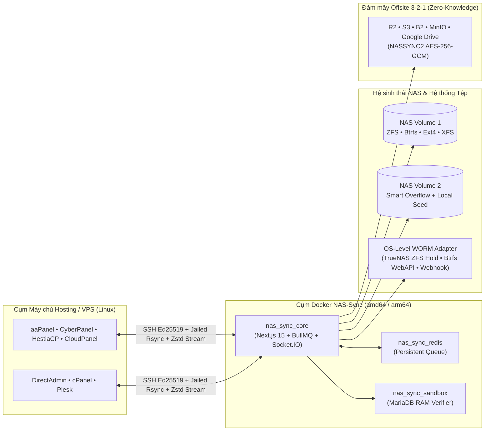

# 🛡️ NAS-Sync — Open-Source Universal Multi-NAS & Docker Backup/Migration Platform

[](https://github.com/shostwp-byte/nas-sync/blob/main/LICENSE)
[](https://github.com/shostwp-byte/nas-sync/releases)
[](https://github.com/shostwp-byte/nas-sync/pkgs/container/nas-sync)
[](https://github.com/shostwp-byte/nas-sync)
[](https://github.com/shostwp-byte/nas-sync/releases)

**NAS-Sync** (<https://github.com/shostwp-byte/nas-sync>) là nền tảng mã nguồn mở **hoàn toàn miễn phí (MIT License)** giúp tự động sao lưu tập trung, kiểm định toàn vẹn cơ sở dữ liệu và khôi phục chéo (Cross-Panel Migration) hàng chục máy chủ Hosting/VPS về **mọi thiết bị NAS và máy chủ Linux có hỗ trợ Docker** (**TrueNAS SCALE, QNAP, UGREEN NASync, TerraMaster, Asustor, Unraid, OpenMediaVault, Proxmox / Ubuntu / Debian Server...**) mà **không cần cài đặt bất kỳ Agent nào lên VPS**.

---

## ✨ Tính năng Cốt lõi (Key Features)

- **🔌 Kiến trúc Agentless Pull Một Chiều & Zero-Impact trên VPS**:
  - Thiết bị NAS chủ động kết nối một chiều qua SSH Key (`Ed25519` / `RSA`) kèm khóa cứng vân tay SSH (`StrictHostKeyChecking=yes` + Multiplexing) về VPS. Nếu VPS bị xâm nhập hoặc nhiễm mã độc, kẻ tấn công **tuyệt đối không có quyền kết nối ngược** để xóa bản sao lưu trên NAS.
  - Mọi tiến trình đọc dữ liệu và xuất SQL trên VPS đều tự động bọc trong `ionice -c 2 -n 7 nice -n 19` và giới hạn băng thông `--bwlimit`, không gây nghẽn CPU hay Disk I/O của website đang vận hành.
- **🗄️ Vận hành Đa Nền tảng NAS & Tự động Kiểm định Hệ thống Tệp**:
  - Chạy nguyên bản trên cả kiến trúc **`linux/amd64`** (Intel/AMD) và **`linux/arm64`** (ARMv8) không cần gắn `/var/run/docker.sock` hay chế độ `privileged`.
  - **POSIX Filesystem & Hard-Link Probe**: Tự động nhận diện loại hệ thống tệp thực tế (`ZFS`, `Btrfs`, `Ext4`, `XFS`, `FUSE`, `SMB/NFS`) và kiểm tra nguyên tử khả năng tạo POSIX Hard-Link / Symlink / quyền ghi ngay trên từng phân vùng trước khi sao lưu.
  - **Smart Multi-Volume Overflow**: Tự động chuyển hướng sang phân vùng lưu trữ kế tiếp khi chạm ngưỡng đầy (`85%`) kèm **Local Seeding** nội bộ bảo toàn chuỗi liên kết cứng.
- **🌐 Tự động Quét 7 Control Panel & Đa Hệ Quản trị CSDL (`MySQL/MariaDB` + `PostgreSQL`)**:
  - Hỗ trợ **DirectAdmin**, **cPanel / WHM**, **Plesk Obsidian**, **aaPanel / BT Panel**, **CyberPanel (OpenLiteSpeed)**, **HestiaCP** và **CloudPanel**: tự động khám phá toàn bộ Domain chính, Addon Domain, Subdomain, System User, PHP Version và ánh xạ chính xác cơ sở dữ liệu **MySQL/MariaDB** lẫn **PostgreSQL (`pg_dump` / `psql`)**.
  - **Sao lưu Mở rộng Hosting**: Tùy chọn sao lưu tăng dần **Hộp thư Email (`Maildir/IMAP`)**, **Lịch Crontab của User** và **Cấu hình Webserver Vhost & SSL** vào phân vùng `system_extras/` của từng Snapshot.
  - **Chống sao lưu trùng lặp (Nested Webroot Deduplication)**: Tự động tách riêng các Subdomain nằm lồng bên trong `public_html` của domain cha và bảo vệ thư mục Subdomain khi chạy Restore domain cha.
- **💾 Sao lưu Tăng dần Hard-Link (`rsync --link-dest`) & Zero-Temp-Disk SQL Stream**:
  - Tiết kiệm **85% – 95% dung lượng ổ cứng NAS**: các tệp không thay đổi giữa các ngày dùng chung Inode vật lý nhưng mỗi ngày vẫn là một cây thư mục hoàn chỉnh độc lập.
  - Luồng nén trực tiếp `mysqldump --single-transaction --quick | zstd -3` qua ống dẫn SSH về thẳng NAS — **không tạo bất kỳ tệp `.tar.gz`/`.sql` tạm nào trên ổ cứng VPS**.
- **🧪 Tự động Thẩm định SQL trên MariaDB RAM Sandbox (`Verified ✅`)**:
  - Sau mỗi ca sao lưu, hệ thống nạp thử các bản dump SQL vào container `nas_sync_sandbox` cô lập trên RAM (`tmpfs`, chế độ `--binary-mode` dưới tài khoản giới hạn đặc quyền) để xác nhận 100% tệp SQL nguyên vẹn trước khi đóng dấu `Verified ✅`.
- **🛡️ Phòng chống Ransomware Đa Tầng (Anomaly Detection + Universal OS-Level WORM)**:
  - Phát hiện sớm tỷ lệ tệp thay đổi hoặc dung lượng tăng đột biến bất thường, gửi cảnh báo khẩn cấp qua **Telegram / Email SMTP** và **tự động ghim khóa (Auto-Pin)** toàn bộ các bản sao lưu sạch trước đó.
  - Tích hợp **Engine OS-Level WORM Snapshot đa nhà cung cấp**: hỗ trợ **TrueNAS SCALE ZFS Snapshot & Kernel Hold API v2.0**, **NAS Btrfs Share Snapshot WebAPI (`is_locked=true`)**, và **Custom Host Webhook ký số `HMAC-SHA256`** cho QNAP QuTS hero / Unraid / OpenMediaVault / Linux ZFS-LVM.
- **☁️ Sao lưu Đám mây Offsite Chuẩn `3-2-1` Zero-Knowledge (`NASSYNC2` — `AES-256-GCM`)**:
  - Nén và mã hóa luồng đầu-cuối (`PBKDF2-HMAC-SHA256` 600.000 vòng + `AES-256-GCM` xác thực Header AAD) đẩy thẳng lên **Cloudflare R2**, **AWS S3**, **Backblaze B2**, **Wasabi**, **MinIO** hoặc **Google Drive (`OAuth2` / `Service Account`)** không tốn ổ cứng tạm, kèm công cụ giải mã độc lập `scripts/decrypt-offsite-backup.mjs`.
- **🔄 Khôi phục 1-Click, Di chuyển Chéo Control Panel & Cập nhật Ký số `Ed25519`**:
  - Khôi phục riêng lẻ Mã nguồn (`Files Only`), Cơ sở dữ liệu (`DB Only`) hoặc toàn bộ (`Full`), tự động viết lại thông tin DB trong `wp-config.php` / `.env` / `env.php` / `configuration.php` an toàn dưới quyền user sở hữu website.
  - Tính năng **1-Click Self-Update** xác thực bắt buộc chữ ký số mật mã **`Ed25519`** và mã băm **`SHA-256`** trước khi áp dụng bản cập nhật.

---

## 🏗️ Kiến trúc Hệ thống Đa Nền tảng



---

## 🗄️ Ma trận Tương thích & Đường dẫn Chuẩn Theo Dòng NAS

Tất cả các hệ thống dưới đây đều hỗ trợ đầy đủ **POSIX Hard-Link (`rsync --link-dest`)**, **MariaDB RAM Sandbox**, **Offsite 3-2-1** và **1-Click Signed Update**:

| Nền tảng NAS / Hệ điều hành | Công cụ Quản lý Docker | Đường dẫn `NAS_VOL1_PATH` Khuyến nghị | Hệ thống Tệp Tối ưu | Cơ chế Khóa WORM Khuyến nghị |
| :--- | :--- | :--- | :--- | :--- |
| **TrueNAS SCALE** | Apps -> Custom App (YAML) / Dockge | `/mnt/<ten-pool>/vps_backups` | `ZFS` | `TRUENAS_ZFS` (ZFS Snapshot + Hold API) |
| **QNAP (QTS / QuTS hero)** | Container Station -> Application | `/share/CACHEDEV1_DATA/VPS_Backups` hoặc `/share/ZFS1_DATA/VPS_Backups` | `Ext4` / `ZFS` | `NONE` (GFS Pin + Offsite) hoặc `WEBHOOK` |
| **UGREEN NASync (UGOS Pro)** | Docker -> Project (Compose) | `/volume1/VPS_Backups` | `Btrfs` / `Ext4` | `NONE` (GFS Pin + Offsite) hoặc `WEBHOOK` |
| **TerraMaster (TOS 5 / 6)** | Docker Manager -> Project | `/Volume1/VPS_Backups` | `Btrfs` / `Ext4` | `NONE` (GFS Pin + Offsite) |
| **Asustor (ADM)** | Portainer CE / Docker Engine | `/volume1/VPS_Backups` | `Btrfs` / `Ext4` | `NONE` (GFS Pin + Offsite) |
| **Unraid OS** | Compose Manager / Dockerman | `/mnt/cache/vps_backups` hoặc `/mnt/disk1/vps_backups` *(ưu tiên hơn `/mnt/user`)* | `ZFS` / `Btrfs` / `XFS` | `NONE` hoặc `WEBHOOK` |
| **OpenMediaVault (OMV)** | omv-extras Compose / Portainer | `/srv/dev-disk-by-uuid-.../vps_backups` | `Ext4` / `Btrfs` / `XFS` / `ZFS` | `NONE` hoặc `WEBHOOK` |
| **NAS Btrfs / DSM-compatible** | Container GUI / Docker Compose | `/volume1/VPS_Backups` | `Btrfs` / `Ext4` | `NAS_WEBAPI` (Immutable Share Lock) |
| **Ubuntu / Debian / Proxmox** | Docker Compose / Portainer / Dockge | `/opt/nas-sync/backups` hoặc `/mnt/storage/backups` | `Ext4` / `XFS` / `ZFS` / `Btrfs` | `NONE` hoặc `WEBHOOK` |

> **Lưu ý quan trọng về hệ thống tệp:** Không đặt `NAS_VOL1_PATH` lên ổ gắn ngoài định dạng **`exFAT` / `FAT32` / `NTFS`** hoặc thư mục mạng **`SMB/CIFS`**, vì chúng không hỗ trợ đầy đủ POSIX Hard-Link và quyền `chmod 0600` cho khóa SSH. Trang **Phân vùng Lưu trữ (`/volumes`)** của NAS-Sync sẽ tự động kiểm tra và hiển thị huy hiệu **`Hard-Link OK`** ngay khi gắn kết thành công.

---

## 🚀 3 Phương thức Cài đặt Nhanh

### Cách 1: Cài đặt Tự động 1 Lệnh qua SSH (`install.sh` — Tự dò loại NAS)

Phù hợp cho mọi dòng NAS và máy chủ Linux có mở SSH. Kịch bản `install.sh` tự động nhận diện nền tảng NAS, nạp đường dẫn binary Docker, sinh khóa bảo mật ngẫu nhiên vào `.env` và khởi chạy toàn bộ cụm container:

```bash
git clone https://github.com/shostwp-byte/nas-sync.git
cd nas-sync
sudo bash install.sh
```

### Cách 2: Chạy Trực tiếp Multi-Arch Image từ GHCR (Portainer / Dockge / Container Station / TrueNAS)

Không cần biên dịch mã nguồn trên NAS — kéo trực tiếp Image đa kiến trúc (`amd64` / `arm64`) đã đóng gói sẵn tại `ghcr.io/shostwp-byte/nas-sync:latest`:

1. Tải tệp `docker-compose.yml` và `.env.example` (đổi tên thành `.env`), mở dòng `image: ghcr.io/shostwp-byte/nas-sync:latest` (và đóng dấu `#` dòng `build: .`).
2. Chỉnh `NAS_VOL1_PATH`, `PUID`, `PGID`, `ADMIN_PASSWORD` phù hợp với thiết bị NAS của bạn.
3. Tạo sẵn thư mục lưu trữ trên NAS khớp với `NAS_VOL1_PATH`, sau đó nhấn **Deploy / Create Application** trên trình quản lý Docker GUI.

### Cách 3: Cài đặt bằng Gói Nén Giao diện Web (`nas-sync-bundle.zip`)

1. Tải gói **`nas-sync-bundle.zip`** tại mục [GitHub Releases](https://github.com/shostwp-byte/nas-sync/releases).
2. Dùng trình quản lý tệp trên giao diện Web của NAS để tải lên thư mục chứa ứng dụng Docker và giải nén ra thư mục `nas-sync` (các thư mục `app_data`, `ssh_keys` đã được tạo sẵn).
3. Nhân bản tệp `.env.example` thành `.env`, chỉnh sửa các thông số bắt buộc (`NAS_VOL1_PATH`, `ADMIN_PASSWORD`, `PUID`, `PGID`), tạo sẵn thư mục lưu trữ sao lưu và khởi chạy dự án từ `docker-compose.yml` (hoặc chạy `sudo bash install.sh` để hệ thống tự sinh `.env` với khóa bảo mật ngẫu nhiên).
4. Truy cập giao diện quản trị tại `http://<IP_NAS_CỦA_BẠN>:3080`.

*(Xem hướng dẫn chi tiết từng bước về phân quyền `PUID/PGID`, cấu hình Cloudflare Tunnel / Reverse Proxy hỗ trợ WebSocket tại [HUONG-DAN-CAI-DAT-NAS.md](./HUONG-DAN-CAI-DAT-NAS.md)).*

---

## ⚙️ Tham chiếu Cấu hình Trọng yếu (`.env`)

| Tham số | Giá trị mặc định | Ý nghĩa & Lưu ý vận hành |
| :--- | :--- | :--- |
| `APP_HOST_PORT` | `3080` | Cổng truy cập giao diện Web trên IP của NAS (`http://<IP_NAS>:3080`). |
| `APP_URL` | `https://backup.example.com` | Tên miền truy cập chính thức (dùng cho liên kết cảnh báo và OAuth2 Callback). |
| `NAS_VOL1_PATH` | `/volume1/VPS_Backups` | Đường dẫn thư mục sao lưu thực tế trên thiết bị NAS ánh xạ vào `/mnt/vol1` trong container. |
| `STORAGE_VOLUMES` | `/mnt/vol1` | Danh sách đường dẫn phân vùng bên trong container (VD: `/mnt/vol1,/mnt/vol2` khi gắn nhiều ổ cứng). |
| `PUID` / `PGID` | `1000` / `1000` | UID/GID chạy tiến trình bên trong container non-root — đặt khớp với tài khoản sở hữu thư mục trên NAS. |
| `ADMIN_USERNAME` / `ADMIN_PASSWORD` | `admin` / `nas-sync@2026` | Tài khoản quản trị khởi tạo lần đầu (khuyến nghị đổi ngay sau khi đăng nhập và bật xác thực 2 lớp **2FA TOTP**). |
| `JWT_SECRET` / `TOTP_ENCRYPTION_KEY` | *(Tự sinh ngẫu nhiên)* | Để trống để hệ thống tự sinh khóa 256-bit lưu bền vững trong `app_data/`, hoặc điền chuỗi hex tối thiểu 32 ký tự. |
| `TRUST_PROXY` | `false` | Chỉ bật `true` khi đặt sau Reverse Proxy / Cloudflare Tunnel tin cậy **và** đã khóa cổng nội bộ `3080` với mạng ngoài. |
| `WORM_PROVIDER` | `NONE` | Cơ chế khóa Snapshot bất biến cấp hệ điều hành (`NONE`, `TRUENAS_ZFS`, `NAS_WEBAPI`, `WEBHOOK` — có thể chọn trực quan trên Web UI). |

---

## 🔑 Kết nối Máy chủ VPS trong 60 Giây

1. Trên giao diện Web **NAS-Sync**, vào mục **Máy chủ VPS & SSH (`/servers`)** -> bấm **Quản lý SSH Keys** -> bấm **+ Sinh Khóa SSH Mới (`Ed25519`)**.
2. Sao chép lệnh gán khóa công khai và chạy trên SSH `root` của VPS cần sao lưu:
   ```bash
   mkdir -p ~/.ssh && chmod 700 ~/.ssh
   echo "ssh-ed25519 AAAAC3... nas-sync" >> ~/.ssh/authorized_keys
   chmod 600 ~/.ssh/authorized_keys
   restorecon -Rv ~/.ssh 2>/dev/null || true
   ```
3. Bấm **Thêm Máy chủ VPS**, điền IP, SSH Port, chọn loại Control Panel (`DirectAdmin` / `cPanel` / `Plesk` / `aaPanel` / `CyberPanel` / `HestiaCP` / `CloudPanel`), xác nhận ghim vân tay SSH Host Key (`TOFU Pinning`) và bấm **Quét thử** để khám phá toàn bộ Domain, Subdomain và Database.

---

## 🔄 Cập nhật Phiên bản Mới An toàn

- **Cách 1 — Cập nhật 1-Click Ký số `Ed25519` ngay trên Giao diện Web (Khuyên dùng)**:
  1. Vào mục **Cấu hình & Cập nhật (`/settings` -> Tab `Cập nhật`)**.
  2. Bấm **Kiểm tra bản mới** -> **Cập nhật ngay**. Hệ thống tự động kiểm tra chữ ký số `Ed25519` (`.sig`) và mã băm `SHA-256`, sao lưu CSDL SQLite + `node_modules` để hỗ trợ hoàn tác tức thì nếu xảy ra sự cố, và tự khởi động lại dịch vụ trong vài giây.
- **Cách 2 — Cập nhật lại toàn bộ Docker Image qua SSH**:
  ```bash
  cd /duong-dan/nas-sync
  sudo bash update.sh
  ```

---

## 💻 Phát triển & Kiểm thử Cục bộ (Windows / macOS / Linux)

Dự án tích hợp sẵn chế độ **Dual-Mode** (tự động chuyển sang In-Memory Queue và Mock Panel Adapter khi chạy trên máy cá nhân không có Redis/SSH thật):

```bash
git clone https://github.com/shostwp-byte/nas-sync.git
cd nas-sync
npm install
npm test
npm run dev
```

Mở trình duyệt tại `http://localhost:3000` để trải nghiệm toàn bộ luồng Backup, Hard-Link Incremental, File Explorer & Diff Viewer, Offsite 3-2-1 và Cross-Panel Restore.

---

## 🤝 Đóng góp & Chính sách Bảo mật

- Hoan nghênh mọi đóng góp mở rộng tính năng, Control Panel Adapter và cơ chế tích hợp NAS mới! Xem chi tiết tại [CONTRIBUTING.md](./CONTRIBUTING.md) và [CODE_OF_CONDUCT.md](./CODE_OF_CONDUCT.md).
- Nếu phát hiện lỗ hổng bảo mật, vui lòng gửi báo cáo riêng tư theo hướng dẫn tại [SECURITY.md](./SECURITY.md).

---

## 📄 Giấy phép (License)

Phát hành hoàn toàn miễn phí dưới giấy phép mã nguồn mở **[MIT License](./LICENSE)** — tự do sử dụng, tùy biến và triển khai cho cả mục đích cá nhân lẫn doanh nghiệp.
